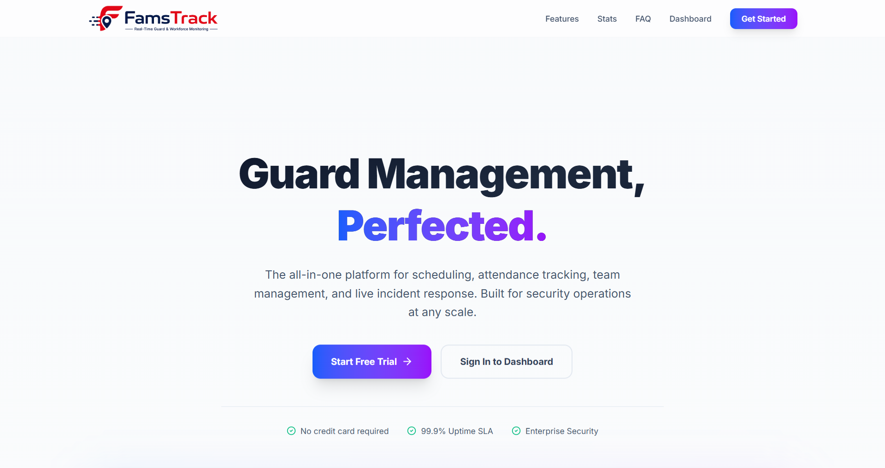

# Hi there, I'm Malik Md Apu Rahman! 👋

### 💼 Currently working as an **Independent Software Consultant**
**Senior Mobile Engineer & Full-Stack Architect** | Founder of [AnZDevelopers](https://www.anzdevelopers.com) 🚀  
*Building scalable, offline-first mobile apps, high-concurrency real-time systems, and interactive digital experiences.*

---

## 👨‍💻 About Me

Autonomous **Senior Mobile Engineer & Full-Stack Architect** with **8+ years of total software engineering experience**, including **5+ years specializing in cross-platform mobile development (iOS & Android)** and high-throughput real-time systems.

- 💼 **Current Focus:** Working as an **Independent Software Consultant**, partnering with clients to architect and ship production-ready mobile applications, scalable cloud backends, and low-latency real-time infrastructure.
- 📱 **Store Releases:** Shipped and maintained enterprise mobile applications on both the **Apple App Store** and **Google Play Store**.
- ⚡ **Core Strengths:** Real-time messaging (WebSockets, Socket.IO, WebRTC), offline-first sync engines with conflict-free reconciliation, push notifications (FCM & APNs), and secure local storage (Keychain / Keystore / Encrypted SQLite).
- 🚀 **Founder:** Building fun, productive, and innovative digital tools at [AnZDevelopers](https://www.anzdevelopers.com).
- 🎓 **Education:** Master of Science (M.Sc.) in Mathematics.

---

## 🛠️ Tech Stack & Proficiencies

### 📱 Mobile & Cross-Platform

### 💻 Backend & Real-Time Communications

### 🌐 Frontend & Web Technologies

### 🗄️ Databases & Caching

### 🎮 Game Development & Interactive Systems

---

## 💼 Work Experience

### 💼 Independent Software Consultant
**Senior Mobile & Systems Consultant**  
*2022 - Present* *(Current)*
- Architect and develop cross-platform mobile applications (Flutter for iOS & Android) connecting to scalable cloud APIs (Node.js, Fastify, ASP.NET Core).
- Design and integrate high-concurrency real-time communication systems (WebSockets, Socket.IO, WebRTC concepts) for live telemetry, chat, and room-based dispatch.
- Implement reliable push notification infrastructure (FCM & APNs) across background, foreground, and terminated states.
- Engineer fault-tolerant offline-first architectures with idempotent event queues, encrypted local storage, and seamless sync-on-reconnect.
- Oversee full App Store lifecycle management (Apple App Store Connect, TestFlight, Google Play Console signing and rollouts).

### 🪄 MagicMind *(US Company, Remote)*
**Senior Unity (C#) Developer & Technical Lead**  
*Sep 2022 - May 2026*
- Led technical architecture and development for the core interactive application (~7,000+ LOC in C#, 60+ controllers).
- Designed structured JSON command protocols and bidirectional WebGL JavaScript bridges (`.jslib`) connecting web front-ends with the Unity engine.
- Built timeline-synchronized multi-channel video/audio engines, dynamic animations, and local caching under strict resource constraints.
- Integrated BLE peripheral sensors (HRV monitors, Muse EEG) with real-time biometric telemetry and ONNX ML inference.
- Authored comprehensive 11-part architecture documentation and developed custom in-engine runtime inspectors to accelerate QA cycles.

### 🏢 SoftNTech
**Lead Developer & Mobile Engineer** _(2020 - 2022)_  
**Junior Mobile Developer** _(2018 - 2020)_
- Led cross-functional teams developing hybrid and cross-platform mobile apps (Ionic / Angular / Capacitor) deployed to iOS and Android.
- Built sub-second real-time socket services for multiplayer interactions and chat.
- Led technical modernization efforts, establishing reusable UI component libraries, automated testing, and Git-flow workflows.

---

## 📂 Featured Projects & Production Apps

### [Famstrack](https://www.famstrack.com) — Enterprise Security & Workforce Management SaaS
*A comprehensive workforce and security management platform featuring a real-time web dashboard, high-throughput backend API, and offline-first mobile apps for field personnel.*

- 🍏 **Apple App Store:** [Famstrack Employee on App Store](https://apps.apple.com/us/app/famstrack-employee/id6782990128)
- 🤖 **Google Play Store:** [Famstrack Employee on Google Play](https://play.google.com/store/apps/details?id=com.famstrack.employee)
- 🎥 **Video Walkthrough:** [YouTube Demonstration](https://www.youtube.com/watch?v=M8YWf6uVqpc)
- 🌐 **Live Website:** [famstrack.com](https://www.famstrack.com)
- **Tech Stack:** SvelteKit (Svelte 5), Fastify (Node.js 20), TypeScript, PostgreSQL, Redis, Socket.IO, Flutter (Dart), Google Maps
- **Key Highlights:**
  - **Offline-First Sync Engine:** Resilient offline queue with UUID idempotency and deduplication; field guards complete tours and capture photo proof offline and auto-sync on reconnect.
  - **Real-Time Operations:** Live GPS patrol tracking, instant dispatch alerts, and live dashboard monitoring powered by room-based Socket.IO streaming.
  - **Enterprise Security:** Multi-tenant architecture with three-tier RBAC (Admin, Manager, Guard) and JWT token rotation.

---

### [Connect Line Puzzle](https://games.anzdevelopers.com/connect-line-puzzle) — Cross-Platform Puzzle Game
*An addictive, high-performance HTML5 and mobile puzzle game with background level synchronization.*

- 🌐 **Play Online:** [Connect Line Puzzle](https://games.anzdevelopers.com/connect-line-puzzle)
- **Tech Stack:** Svelte 5, TypeScript, Capacitor (iOS & Android native runtime), HTML5 Canvas, SQLite
- **Key Highlights:**
  - Custom procedural 2D canvas rendering engine with dynamic glow effects and vector collision algorithms.
  - Bidirectional offline-first sync engine for community-published levels and global leaderboards.
  - State management powered by Svelte 5 runes (`$state`).

---

### [Smart Database Manager](https://github.com/mmar58/Smart_Database_Manager) — Real-Time Database Management Tool
*A modern web-based management GUI for MySQL and PostgreSQL databases with AI assistance.*

- 💻 **GitHub Repository:** [mmar58/Smart_Database_Manager](https://github.com/mmar58/Smart_Database_Manager)
- **Tech Stack:** Svelte 5, TypeScript, Node.js, Express, Socket.IO, Tailwind CSS v4, MySQL, PostgreSQL, Ollama
- **Key Highlights:**
  - Real-time schema and data management with CodeMirror 6 SQL editor and visual ER diagram generation.
  - Integrated local LLMs (Ollama) for natural language SQL query generation and structural database insights.
  - Server-side paginated data grids with dynamic sorting and live updates via Socket.IO.

---

### [Video Gallery](https://github.com/mmar58/video-gallery) — Self-Hosted AI Video Gallery
*Performant, self-hosted media platform featuring automated tagging and timeline navigation.*

- 💻 **GitHub Repository:** [mmar58/video-gallery](https://github.com/mmar58/video-gallery)
- **Tech Stack:** SvelteKit, Node.js, Express, FFmpeg, Ollama, Socket.IO, Tailwind CSS
- **Key Highlights:**
  - Automated video categorization and tagging powered by local LLMs via Ollama.
  - Background FFmpeg pipeline for animated preview and thumbnail generation.
  - High-performance infinite scroll gallery and persistent, floating smart video player.

---

### Coin Flip — Real-Time Betting Platform
*Live multiplayer betting system with sub-second resolution and crypto transaction handling.*

- **Tech Stack:** Unity, Node.js, Redis, Socket.IO, MySQL, REST API
- **Key Highlights:**
  - Low-latency real-time engine delivering live betting rounds, instant bet settlements, and win/loss tracking.
  - Auditable cryptocurrency deposit, withdrawal, and transfer balance ledgers with secure game logic.

---

## 📫 Connect & Collaborate

- 💼 **Current Status:** Available for consulting & engineering engagements as an **Independent Software Consultant**
- 📧 **Email:** [rahmanapu118@gmail.com](mailto:rahmanapu118@gmail.com)
- 🌐 **Website & Portfolio:** [anzdevelopers.com](https://www.anzdevelopers.com)
- 💬 **Get in Touch:** [anzdevelopers.com/contact](https://www.anzdevelopers.com/contact)
- 💼 **Upwork:** [Hire me on Upwork](https://www.upwork.com/freelancers/~01592faa28412cc5a0)
- 💼 **Fiverr:** [Hire me on Fiverr](https://www.fiverr.com/mmar58)
- 🐙 **GitHub:** [github.com/mmar58](https://github.com/mmar58)

